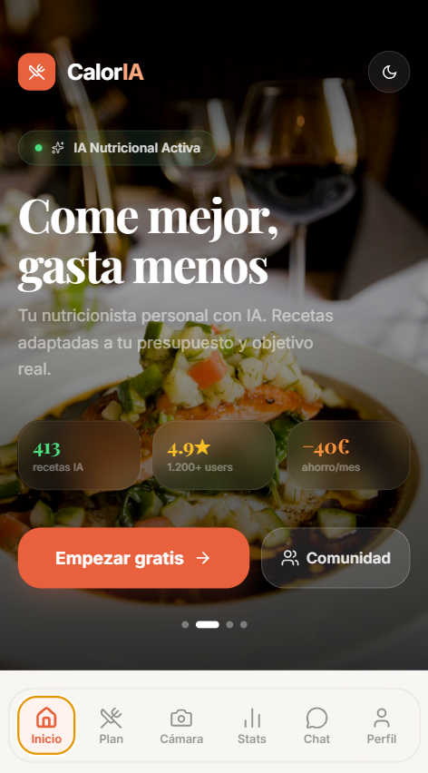
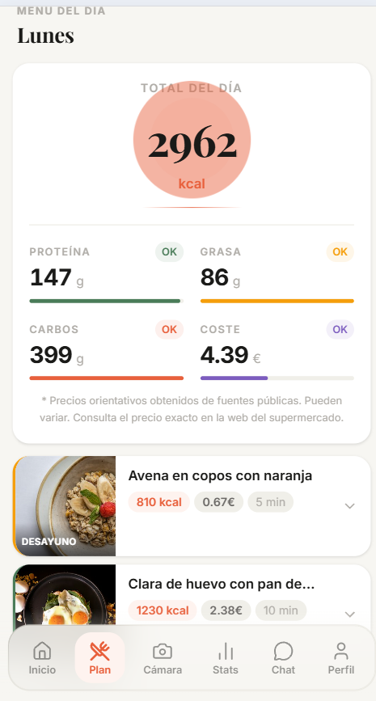
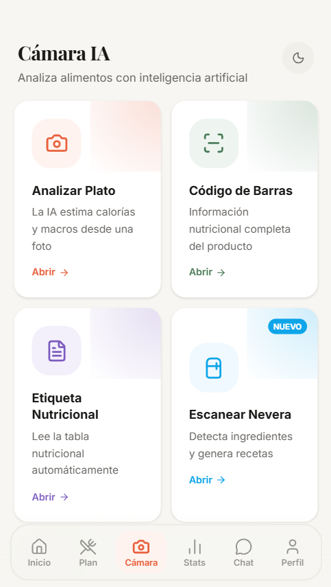

# 🥗 CalorIA

**Planificador nutricional con IA que genera dietas personalizadas según tus objetivos y las optimiza por precio con productos reales de supermercados españoles.**

> Proyecto personal y educativo. Antes se llamaba *MuseMeal*.

<p align="center">
  
  
  
</p>

---

## ✨ Funcionalidades

- **Dietas personalizadas**: calcula tu gasto energético (TDEE) a partir de tu perfil y objetivo (perder peso, mantener o ganar músculo), y genera un plan de comidas que cuadra con tus calorías y macros.
- **Optimización por precio**: elige tu supermercado (Mercadona, Carrefour, Consum o Gadis) y el motor monta el plan con productos reales, buscando el menor coste posible para tus objetivos nutricionales.
- **Escáner de alimentos**, en cuatro modos:
  - 📷 **Foto del plato**: estima calorías y macros a partir de una imagen.
  - 🏷️ **Etiqueta nutricional**: lee la tabla de valores de un envase.
  - 🔢 **Código de barras**: consulta el producto en OpenFoodFacts.
  - 🧊 **Nevera**: detecta qué tienes en casa para aprovecharlo.
- **Chat nutricional**: un asistente para resolver dudas sobre tu dieta.
- **Estadísticas y progreso**: seguimiento de peso y de objetivos.
- **Cuentas de usuario**, modo claro y oscuro, y pantallas legales (privacidad, términos y consentimiento RGPD).

## 🛠️ Stack

| Capa | Tecnologías |
|---|---|
| **Frontend** | React, Vite, Tailwind CSS |
| **Backend** | Python, FastAPI, Uvicorn |
| **Base de datos** | SQLite |
| **IA / visión** | Groq (análisis de imágenes) |
| **Datos** | Catálogos de supermercados (scrapers propios) y OpenFoodFacts |

## 🏗️ Arquitectura

```
CalorIA/
├── app/                    # Backend (FastAPI)
│   ├── api/                # Endpoints: auth, productos, escáner
│   ├── engine/             # Motor de dietas y generación de nombres de recetas
│   ├── scraper/            # Scrapers por supermercado + normalizador de productos
│   ├── models/ schemas/    # Modelos de datos y validación
│   ├── db/                 # Sesión y carga inicial de la base de datos
│   └── utils/
├── frontend/               # Aplicación web (React + Vite)
│   └── src/
│       ├── tabs/           # Inicio, Plan, Cámara, Chat, Estadísticas, Perfil
│       ├── components/     # Escáneres, autenticación, resultados, UI
│       ├── hooks/          # Perfil, dieta, autenticación, tema
│       └── utils/tdee.js   # Cálculo del gasto energético
├── scripts/                # Scraping, limpieza del catálogo, entrenamiento y pruebas
└── requirements.txt
```

### Cómo se genera una dieta

1. **Perfil → objetivos**: con edad, peso, altura, actividad y objetivo se calculan el TDEE y el reparto de macros.
2. **Catálogo**: los scrapers obtienen productos y precios de cada supermercado, y el normalizador los unifica (categorías, gramos por envase, valores nutricionales).
3. **Motor de dietas**: combina productos del supermercado elegido para cumplir las calorías y macros de cada comida, minimizando el coste total.
4. **Resultado**: plan de comidas con macros por comida y precio estimado.

## 🚀 Ejecutar en local

### Requisitos
- Python 3.10+
- Node.js 18+
- Una clave de API de [Groq](https://console.groq.com/)

### 1. Clonar el repositorio
```bash
git clone https://github.com/Marcosrgueez/CalorIA.git
cd CalorIA
```

### 2. Backend
```bash
python -m venv .venv
# Windows
.venv\Scripts\activate
# macOS / Linux
source .venv/bin/activate

pip install -r requirements.txt
```

Crea un archivo `.env` en la raíz con tus variables:
```env
GROQ_API_KEY=tu_clave_aqui
```

Carga el catálogo inicial y arranca el servidor:
```bash
python scripts/seed_catalog.py
python -m uvicorn app.main:app --reload --port 8001
```

> El frontend redirige las peticiones al backend en el puerto **8001** (configurado en `frontend/vite.config.js`).

### 3. Frontend
```bash
cd frontend
npm install
npm run dev
```

La app quedará disponible en `http://localhost:5173` (o en el puerto que indique Vite en la consola).

## ⚠️ Aviso

- Es un **proyecto educativo**, sin ánimo de lucro y **sin relación comercial** con Mercadona, Carrefour, Consum ni Gadis. Las marcas pertenecen a sus respectivos titulares.
- Los **precios son orientativos**, se obtuvieron de fuentes públicas y pueden no coincidir con los actuales.
- CalorIA **no es un servicio médico ni nutricional profesional**. Sus recomendaciones son orientativas y no sustituyen a un médico o nutricionista.

## 👤 Autor

**Marcos**: estudiante del Grado en Inteligencia Artificial en la Universidade de Vigo.

[GitHub](https://github.com/Marcosrgueez)
